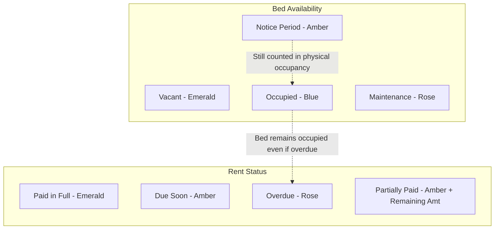

# ROOVIO PG Manager — Design System & Architecture Specification

This document details the visual tokens, interface architecture, status semantics, and interaction paradigms of **ROOVIO PG Manager**, as well as the design specification for an optional public landing page.

---

## 1. Visual Tokens

The interface follows a clean, utilitarian operations dashboard aesthetic optimized for rapid readability in both bright outdoor daylight and indoor reception counters.

### 1.1 Color Palette

| Token Name | Hex Code | Purpose & Usage |
| :--- | :--- | :--- |
| **Primary Brand** | `#2563EB` | Royal Blue. Navigation highlights, primary buttons, brand accents. |
| **Main Heading / Text** | `#0F172A` | Slate 900. High-contrast typography for names, amounts, headers. |
| **Secondary Text** | `#475569` | Slate 600. Helper text, room labels, sub-values, timestamps. |
| **Page Background** | `#F8FAFC` | Slate 50. Soft off-white backdrop reducing eye strain. |
| **Card Background** | `#FFFFFF` | Pure White. Surface containers for room blocks, tables, cards. |
| **Card Borders** | `#E2E8F0` | Slate 200. Clean structural division without heavy drop shadows. |
| **Success Pale / Text** | `#ECFDF5` / `#065F46` | Emerald. Full rent paid, vacant beds, positive cash flow. |
| **Warning Pale / Text** | `#FFFBEB` / `#92400E` | Amber. Notice period, partial rent paid, due soon, pending notice. |
| **Danger Pale / Text** | `#FFF1F2` / `#9F1239` | Rose. Overdue rent, maintenance beds, negative cash flow. |

### 1.2 Typography & Numerals
- **Typeface:** Inter, with fallback system sans-serif (`system-ui, -apple-system, BlinkMacSystemFont, Segoe UI, Roboto, sans-serif`).
- **Base Size:** 16px body text scale with clean hierarchical step-downs (14px, 12px, 11px, 10px).
- **Tabular Numerals (`tabular-nums`):** Strictly applied to all Indian Rupee (`₹`) amounts, bed counters, and financial tables so figures align vertically without horizontal jitter.

### 1.3 Radii & Shadows
- **Card Radii:** `12px` to `16px` (`rounded-xl` / `rounded-2xl`) providing a modern, approachable feel.
- **Button Radii:** `10px` to `12px` (`rounded-xl`).
- **Elevation:** Subtle `shadow-xs` / `shadow-sm` borders (`border-slate-200`) to maintain a calm, flat operational hierarchy without distraction.

---

## 2. Independent Status Semantics

To prevent operational ambiguity, **Bed Availability** and **Tenant Rent Status** are kept strictly independent. Never communicate meaning through color alone; every badge must contain an explicit text label.



### 2.1 Bed Availability Semantics
1. **Vacant (Emerald):** Physical bed is free and ready for immediate allocation.
2. **Occupied (Blue):** Bed is allocated to an active paying tenant.
3. **Notice Period (Amber):** Tenant has announced their checkout date. Bed remains occupied until actual physical checkout.
4. **Maintenance (Rose):** Out of order (e.g. broken frame, painting, deep cleaning). Unavailable for new allocation.

### 2.2 Rent Dues Semantics
1. **Paid in Full (Emerald):** Zero remaining balance on current billing month charge.
2. **Due Soon (Amber):** Payment due on or before month-end, prior to the reference date.
3. **Overdue (Rose):** Due date has passed demo clock (29 Oct 2026) and balance > ₹0. *Note: An overdue tenant's bed remains occupied.*
4. **Partially Paid (Amber):** Partial installment received; displays remaining balance clearly.

### 2.3 Bunk Bed & Individual Berth Architecture
1. **Separately Managed Sleeping Spaces:** Each physical bunk bed frame holds two independent sleeping spaces:
   - **Upper Berth (`tier: 'upper'`):** Accessed via ladder; configured with its own monthly rent rate (e.g. ₹6,000/mo).
   - **Lower Berth (`tier: 'lower'`):** Ground level; configured with its own monthly rent rate (e.g. ₹6,500/mo).
2. **Canonical Berth IDs:** Every sleeping space has a globally unique, readable ID:
   - Bunk berths: `Room [Num] - [BunkGroup] - [Upper|Lower]` (e.g. `Room 101 - Bunk 1 - Upper`, `Room 101 - Bunk 1 - Lower`).
   - Single beds: `Room [Num] - [BedLabel]` (e.g. `Room 101 - Bed 1`).
3. **Independent Lifecycle:** Each berth has its own occupancy status, tenant assignment, rent charges, payment history, and checkout clearance.
4. **Capacity & Financial Aggregation:** All dashboard metrics (capacity, occupied beds, vacant beds, expected rent, collected rent, remaining balance) are computed strictly across **individual berths**, never physical bunk frames.
5. **Physical Bed Grouping in Visual Layouts:** In the Building view, rooms render bunk beds enclosed in unified physical frame containers displaying the Upper Berth above the Lower Berth with tier indicators (`🪜 Upper Berth` / `🛏️ Lower Berth`), status pills, tenant names, and individual action buttons.
6. **Deletion & Structural Protection:** An owner can add or remove bunk beds or individual berths, but removing any berth or bunk bed frame that has an active or notice tenant is strictly blocked until the tenant is checked out or reassigned.

### 2.4 Document Verification Status Semantics
1. **Pending Verification (Amber):** File has been uploaded by or on behalf of tenant; awaiting manual verification by PG owner.
2. **Verified (Emerald):** PG owner has visually inspected the document against tenant identity; marked with verified timestamp and reviewer identity.
3. **Rejected (Rose):** PG owner rejected document (e.g. illegible, expired, or mismatch). **Mandatory non-empty rejection reason required.**
4. **Document Replacement:** When a document is replaced with a new file, verification status is automatically reset to `pending` to ensure audit integrity.

---

## 3. Responsive Application Shell Structure

### 3.1 Desktop Shell (≥ 768px)
```
+-----------------------------------------------------------------------------------+
|  [Demo Notice Banner: Interactive Demo Mode • Stored on this device]               |
+---------------+-------------------------------------------------------------------+
| ROOVIO PG     | [Page Title]      [Billing Month Selector]   [Demo Tag] [+ Add]   |
| Executive PG  +-------------------------------------------------------------------+
|               |  [4-Column KPI Summary Cards: Occupancy, Rent, Expenses, Flow]    |
| • Dashboard   +---------------------------------+---------------------------------+
| • Building    |  [Items Requiring Attention]    |  [Pending Rent Follow-Up List]  |
| • Tenants     |  - Overdue Tenants (4)          |  - Tenant A: ₹6,500 due         |
| • Facilities  |  - Notice Active (2)            |  - Tenant B: ₹6,500 due         |
| • Expenses    |  - Open Tickets (4)             |  [Compact Room Availability]    |
| • Settings    +---------------------------------+---------------------------------+
|               |                                                                   |
| [Device Tag]  |                                                                   |
+---------------+-------------------------------------------------------------------+
```

### 3.2 Mobile Shell (< 768px, down to 360px viewport)
- **Top Sticky Header:** Compact brand logo, title, billing month dropdown, and settings gear.
- **Content Container:** 2-column compact metric cards, full-width touch cards, 0 horizontal overflow at 360px.
- **Fixed 5-Tab Bottom Navigation:**
  1. `Home` (`LayoutDashboard`)
  2. `Building` (`Building2`)
  3. `Tenants` (`Users`)
  4. `Facilities` (`Wrench`)
  5. `Expenses` (`ReceiptIndianRupee`)
- **Touch Targets:** Minimum 44px × 44px on all touchable elements.
- **Safe Area Padding:** Accommodates iOS and Android virtual home indicators with `pb-[env(safe-area-inset-bottom)]`.

### 3.3 Tenant Profile & Document Management Architecture (`/tenants/:tenantId`)
The Tenant Details Page is structured into 5 cohesive operational sections:
1. **Contact Information & Permanent Address:** Primary phone with WhatsApp action, alternate phone, email, move-in date, and structured permanent address (house, locality, district, state, 6-digit PIN code).
2. **Employment & Workplace:** Employer/company badge, occupation/job title, office address, and workplace contact number.
3. **Emergency Contact Person:** Name, relationship badge (Parent, Spouse, Sibling, Guardian), and direct call/copy action.
4. **Rental & Berth Management:** Room number, berth badge (Upper/Lower/Single), monthly rent, deposit ledger, stay audit trail, and payment receipts.
5. **Identity & Document Management:**
   - Visual cards showing document type, upload timestamp, file size, masked number (`•••• •••• 1234`), and verification badge.
   - Secure in-modal file previewer with temporary object URLs revoked on close.
   - Secure download handler with filename sanitization.
   - Verification status modal requiring mandatory rejection reasons.
   - Re-upload / replacement modal automatically resetting status to `pending`.
   - Complete document removal with double confirmation.

---

## 4. Key Interaction & Workflow Decisions

1. **Explicit First-Month Billing Policy:** During onboarding, operators must explicitly choose between *Full Month Charge* or *Daily Prorated Charge*. The application does not silently invent billing rules.
2. **Strict Non-Negative & Balance Guards:** Payments exceeding the outstanding balance are immediately blocked with an inline explanation to prevent erroneous manual accounting entries.
3. **Safe CSV Export:** Cells with mathematical prefixes (`=`, `+`, `-`, `@`) are prepended with an apostrophe to guard against CSV injection attacks in Excel or Google Sheets.
4. **Masked Phone Protection:** Fictitious seed demo numbers (`+91 98451 XXXXX`) disable external `wa.me` links with a clear explanatory banner, while still supporting full template preview and clipboard copying.
5. **Segregation of Security Deposits:** Tenant security deposits are treated as refundable balance-sheet liabilities and are strictly excluded from rent-minus-expenses monthly cash flow.

---

## 5. Optional Public Landing-Page Concept

When deploying a public-facing website alongside the management dashboard, this concept maintains visual coherence with the operational tool:

### 5.1 Hero Section
- **Heading:** *"Your PG, organised."*
- **Sub-headline:** *"Track occupancy, collect rent on time, manage room inventory, and understand monthly cash flow without spreadsheets or lost notebooks."*
- **Primary CTA:** `Explore Interactive Demo` (routes to `/`)
- **Secondary CTA:** `Sign In` (reserved for production auth integration)
- **Visual:** High-resolution mockup of ROOVIO PG Manager's Building Matrix and Rent Dues Table.

### 5.2 Key Value Pillars
1. **Never Lose Track of a Vacant Bed:** Live visual bed matrix across floors with instant allocation.
2. **Rent Collection Without the Awkward Follow-Ups:** Automated WhatsApp reminders and digital receipts with UPI details.
3. **True Operating Cash Flow:** Know exactly where your money went after electricity, staff salary, water tankers, and mess groceries.
4. **Maintenance & Room Inventory:** Track geysers, AC remotes, mattresses, and keys upon move-in and checkout.

### 5.3 Step-by-Step "How It Works"
1. **Set Up Your Floors & Rooms:** Configure single, double, triple, or four-sharing rooms with AC options.
2. **Onboard Tenants in Under a Minute:** Record rent, deposit, and assigned room keys.
3. **Generate Monthly Charges:** Issue rent cycles with one click; record UPI, Cash, or Bank Transfers.
4. **Stay Ahead of Repairs:** Resolve maintenance tickets and track actual expenses seamlessly.

### 5.4 Frequently Asked Questions (FAQ)
- **Q: Does this replace my physical register?**  
  *A: Yes. You can record all room allocations, security deposits, and maintenance issues digitally.*
- **Q: Can I access this on my smartphone?**  
  *A: Yes. The web application is built mobile-first and installs as a Progressive Web App (PWA) with offline support.*
- **Q: How does WhatsApp reminder generation work?**  
  *A: ROOVIO generates formatted reminder templates with your property's UPI ID and room details, which open directly in WhatsApp.*

---

## 6. Accessibility & Motion Guidelines

- **Focus Rings:** Distinct 2px royal blue outline (`focus:ring-2 focus:ring-brand-500`) for all keyboard navigations.
- **Focus Trapping:** Active in all modals and drawer sheets; Escape key closes dialogs and restores focus to the triggering element.
- **Color Contrast:** All body text meets WCAG AA (contrast ratio > 4.5:1 against `#FFFFFF` and `#F8FAFC`).
- **Reduced Motion:** CSS animations respect `@media (prefers-reduced-motion: reduce)`.

