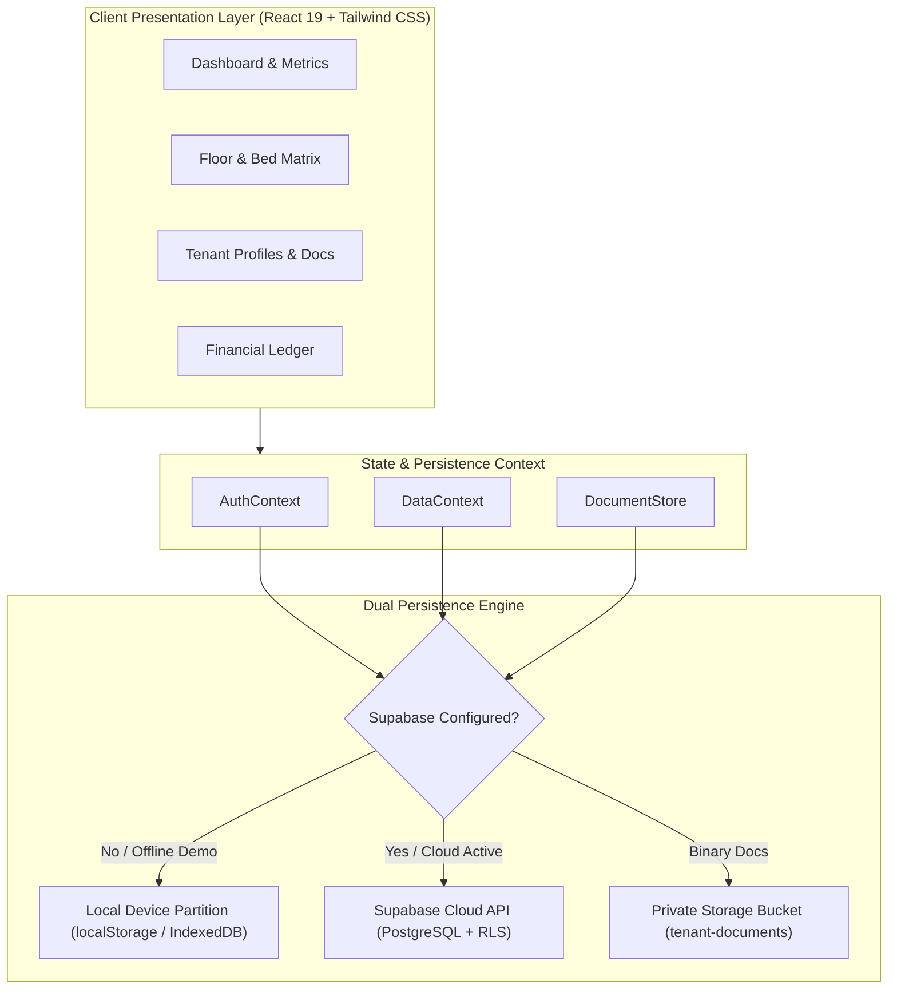

# ROOVIO — Intelligent PG & Hostel Operations Platform

<p align="center">
  
</p>

<p align="center">
  <strong>Enterprise-grade property operations dashboard engineered for Indian Paying Guest (PG) and hostel operators.</strong>
</p>

<p align="center">
  
  
  
  
  
  
  
</p>

---

## 📌 Project Overview & Purpose

**ROOVIO** is a production-grade operations management web application built specifically for owners and managers of Paying Guest (PG) accommodations, student hostels, and co-living spaces in India.

### ⚠️ Portfolio Project Disclaimer
> **Notice:** This repository represents a comprehensive portfolio demonstration project engineered to showcase full-stack system architecture, TypeScript engineering, responsive enterprise UI/UX, and domain-specific operational modeling. It is demonstrated with fictional Kerala-based seed data (Kannur and Kozhikode districts). While fully functional with optional Supabase cloud persistence and offline local storage, it is not currently operated as a commercial SaaS subscription.

---

## 🎯 The Problem ROOVIO Solves

Managing student hostels and working professionals' PGs in India involves unique operational constraints that generic western property management tools fail to address:

1. **Bunk Bed & Berth Granularity:** Commercial rentals lease entire apartments; hostels lease individual sleeping berths within physical bunk frames. A 2-bunk room contains 4 distinct billable inventory units (Upper vs. Lower berths), each with independent occupancy, differing rents, and separate tenant agreements.
2. **Tenant-Specific Meal Plans:** Food plans in Indian PGs vary by tenant (e.g., veg/non-veg, 3-meal full board, dinner-only, or room-only). Food charges must be managed per resident, not per room.
3. **Cash-Flow & Partial Collections:** Rent in Indian PGs is often paid in multiple partial UPI or cash installments across the billing cycle. Rigid binary "paid/unpaid" models cause reconciliation disputes.
4. **Deposit Separation:** Security deposits must be tracked separately from monthly operating revenue so operating cash flows aren't artificially inflated.
5. **Regulatory & Identity Hygiene (DPDP):** Indian regulations require government ID and police verification records, while the Digital Personal Data Protection (DPDP) norms mandate masking sensitive identity numbers (such as Aadhaar).

---

## ✨ Key Capabilities & System Features

### 1. Operations Command Center (Dashboard)
- **Real-Time KPI Metrics:** Live tracking of Bed Occupancy Rate, Expected vs. Collected Rent, Monthly Operating Expenses, and Net Operating Cash Flow.
- **Attention Center:** Actionable alerts highlighting overdue rent balances, tenants currently serving vacate notice, and open maintenance tickets.
- **Floor & Bed Matrix Overview:** High-density, color-coded live berth visualizer showing instant availability across all floors with one-click navigation.
- **One-Click Quick Actions:** Rapid tenant onboarding, quick payment recording, room generation, and batch monthly charge calculation.

### 2. Multi-Building & Visual Bed Matrix
- **Physical Hierarchy:** `Property (Building) → Floor → Room → Berth (Single / Bunk Upper / Bunk Lower)`.
- **Individual Berth Tracking:** Unique canonical IDs (`Room 101 - Bunk 1 - Upper`, `Room 101 - Bunk 1 - Lower`) with independent pricing, tenant allocation, and vacate tracking.
- **Visual Bunk Bed Frames:** Grouped display of physical double-decker bunks with clear tier indicators (`↑ Upper` / `↓ Lower`) and status badges.
- **Room Lifecycle States:** Safe room editing, capacity adjustment, temporary closure, retirement, storage conversion, and occupancy-aware safe deletion (preventing deletion of rooms with active residents).

### 3. Tenant Management & Financial Accounting
- **Comprehensive Tenant Profiles:** Multi-attribute profiles capturing primary/alternate phones, employment details, emergency contacts, permanent address with PIN code, and complete stay history.
- **Tenant-Specific Meal Configuration:** Customizable food options (`no_food`, `food_included`, `food_separate`, `custom`) with specific meal selections (Breakfast, Lunch, Dinner).
- **Non-Binary Rent Accounting:** Independent `RentCharge` and `PaymentRecord` ledgers supporting partial payments, advance rent, discount tracking, and overpayment prevention.
- **Printable Receipts:** Computer-formatted rent receipts with receipt numbers, billing periods, payment mode, and print-optimized stylesheets.
- **WhatsApp Follow-ups:** One-click pre-formatted WhatsApp reminder templates for overdue rent and move-out notifications.

### 4. Privacy-First Identity & Document Management
- **Aadhaar Masking:** Automatic masking retaining only the last 4 digits (`•••• •••• 1234`). Full 12-digit Aadhaar numbers are never logged or exported.
- **Verification Lifecycle:** Formal document verification workflow (`Pending Verification`, `Verified`, `Rejected` with mandatory reason). Document replacement triggers automatic status reset.
- **Secure Storage Architecture:** Document binary payloads are isolated in private cloud buckets or local memory with short-lived signed URLs. Raw document files are never leaked into `localStorage` or CSV exports.

### 5. Facility Maintenance & Operating Cash Flow
- **Maintenance Ticketing:** Categorized issue tracking (Plumbing, Electrical, Wi-Fi, Cleaning, Appliances) with priority levels (Low, Medium, High, Urgent).
- **Ticket-to-Expense Conversion:** Verified maintenance expenses convert into operating expenses with double-conversion protection.
- **Operating Ledger:** Categorized expenses for KSEB electricity, Kerala Water Authority (KWA), high-speed fiber broadband, mess groceries, staff salaries, and routine maintenance.
- **Formula-Injection Safe CSV Export:** Sanitized CSV downloads preventing spreadsheet formula injection (`=`, `+`, `-`, `@`).

---

## 📸 Screenshots & Visual Interface

| Operations Dashboard & Key Metrics | Visual Bed Matrix & Room Management |
| :---: | :---: |
| <br><sub>Live property health, occupancy KPI, and cash flow</sub> | <br><sub>Interactive bunk-bed tier matrix with floor filters</sub> |

> **Note:** Additional high-resolution interface captures and animated walkthroughs can be captured from the local development server (`npm run dev`) or live deployment.

---

## 🏗️ System Architecture & Data Flow

ROOVIO implements a **resilient dual-mode architecture**: it functions offline immediately with client-side isolation, and automatically upgrades to Supabase PostgreSQL cloud persistence when valid cloud environment variables are present.



### Data Isolation & Multi-Owner Security
- Every data entity (`Property`, `Floor`, `Room`, `Bed`, `Tenant`, `RentCharge`, `Payment`, `Expense`) belongs to an authenticated owner UUID (`ownerId`).
- **Cloud Mode:** PostgreSQL Row-Level Security (RLS) policies enforce `owner_id = auth.uid()`.
- **Demo Mode:** Separate storage keys (`greenview_app_state_v1_${ownerId}`) prevent data collision between demo accounts.

---

## 💻 Technology Stack

| Layer | Technologies |
| :--- | :--- |
| **Frontend Framework** | React 19.3 + TypeScript 7.0 |
| **Build & Bundler** | Vite 8.3 (Rollup code-split bundles, PWA Service Worker) |
| **Styling & Design System** | Tailwind CSS 3.4 (Custom color tokens, Inter font, tabular figures) |
| **Icons** | Lucide React |
| **Routing** | React Router 7.18 (Code-split route lazy loading) |
| **Cloud Backend (Optional)** | Supabase (PostgreSQL 15+, Row-Level Security, Auth, Storage) |
| **Testing** | Vitest 5.0 (Unit, integration, and security assertion tests) |
| **Code Quality** | Oxlint + TypeScript strict compiler checks |

---

## 🚀 Getting Started (Local Development)

### Prerequisites
- **Node.js:** v18.0.0 or higher (developed & tested on Node v24)
- **npm:** v9.0.0 or higher

### 1. Installation
```bash
# Clone the repository
git clone https://github.com/your-username/roovio-pg-manager.git

# Navigate to project directory
cd roovio-pg-manager

# Install dependencies
npm install
```

### 2. Environment Configuration (Optional)
ROOVIO works out-of-the-box in local demo mode without any cloud setup. To connect your own free Supabase cloud database:

```bash
# Copy the example environment file
cp .env.example .env
```

Edit `.env` with your project credentials from your Supabase dashboard:
```env
VITE_SUPABASE_URL=https://your-project-id.supabase.co
VITE_SUPABASE_ANON_KEY=your-anon-public-key
```

### 3. Start Development Server
```bash
npm run dev
```
Open `http://localhost:5173` in your browser.

### 4. Running Automated Tests
```bash
npm test
```
Executes all **63 comprehensive test cases** across 3 test suites:
- `src/tests/workflows.test.ts`: 39 business logic and workflow tests.
- `src/tests/cloudPersistence.test.ts`: 16 multi-owner RLS and cloud persistence tests.
- `src/tests/floorBedMatrix.test.tsx`: 8 visual matrix, floor formatting, and responsive layout tests.

### 5. Running Production Build & Linter
```bash
# TypeScript verification & optimized production build
npm run build

# Fast syntax and code hygiene verification
npm run lint
```

---

## 🗄️ Database Setup (Supabase PostgreSQL)

If deploying with Supabase, run the schema scripts in the Supabase **SQL Editor**:
1. Base Unified Schema: [`supabase/schema.sql`](supabase/schema.sql)
2. Additional Feature Migrations: [`supabase/migrations/`](supabase/migrations/)
   - `20261029_multi_building_rooms.sql`
   - `20261029_owner_controlled_pricing.sql`
   - `20261029_room_lifecycle_management.sql`
   - `20261029_cloud_persistence_reconciled.sql`

All tables enforce strict Row Level Security (RLS):
```sql
CREATE POLICY "Owners can manage their own rooms and beds"
    ON public.rooms FOR ALL
    USING (owner_id = auth.uid())
    WITH CHECK (owner_id = auth.uid());
```

---

## 👥 Demo Accounts & Fictional Kerala Dataset

ROOVIO comes preloaded with realistic fictional operations data centered in **Kannur and Kozhikode districts, Kerala**:

| Demo Account | Property Name | Location | Capacity |
| :--- | :--- | :--- | :--- |
| **Kozhikode Flagship** | ROOVIO Malabar Residency PG | Mavoor Road, Kozhikode | 22 Berths (16 Occupied, 6 Vacant) |
| **Kannur Branch** | Thavakkara Comfort PG | Near Railway Station, Kannur | 18 Berths |
| **Kozhikode Urban** | Nadakkavu Urban Stay | Nadakkavu, Kozhikode | 14 Berths |

> **Privacy Guarantee:** All resident names, contact phone numbers (`+91 98451 XXXXX`), Aadhaar IDs (`•••• •••• 4120`), and financial accounts in the demo fixtures are purely fictional. No real individual's private information is contained in this repository.

---

## 🔒 Security & Privacy Practices

- **Zero Secret Exposure:** Client `.env` files with private tokens are strictly ignored by `.gitignore`. The repository contains only `.env.example`.
- **Aadhaar Privacy (DPDP):** Full Aadhaar numbers are never stored in plain text or rendered in client tables. CSV exports strip all document URLs and identity tokens.
- **Sanitized Formula Exports:** All CSV export routines prepend leading apostrophes to characters (`=`, `+`, `-`, `@`) to neutralize CSV Injection attacks in Excel/Google Sheets.
- **Fail-Safe Persistence:** When cloud synchronization fails, errors are rendered explicitly to the owner rather than masking failure as success.

---

## ⚠️ Known Limitations & Future Roadmap

### Current Scope & Limitations
- **Manual Verification:** Document verification reflects the PG owner's manual review; it is not hooked into automated UIDAI/DigiLocker APIs.
- **Payment Gateway:** Records UPI and cash transactions; direct automated in-app payment collection via Razorpay/Cashfree is planned for v2.
- **SMS Gateway:** Payment reminders are routed via pre-filled WhatsApp templates rather than automated SMS gateway dispatch.

### Planned Enhancements
- [ ] Automated biometric / biometric attendance integration.
- [ ] Integration with Razorpay UPI payment webhooks for automatic rent receipt reconciliation.
- [ ] DigiLocker instant Aadhaar verification via Government API.
- [ ] Multi-lingual interface support (Malayalam, Hindi, Tamil, Kannada).

---

## 📄 License & Intellectual Property

**License Status:** Undecided / Portfolio Showcase.  
All brand assets, custom component designs, and code architectures are presented for portfolio demonstration, technical evaluation, and educational inspection. Commercial reuse or distribution rights remain reserved by the project author.
